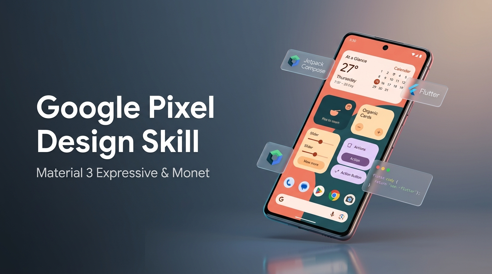

# Google Pixel Design Skill (`google-pixel-design-skill`)

[](https://m3.material.io/blog/building-with-m3-expressive)
[](https://store.google.com/category/phones)
[](https://skills.sh)
[](LICENSE)

<p align="center">
  
</p>

An AI design reviewer and code generator grounded in **Google's Material Design 3 (M3) Expressive** guidelines and the signature **Google Pixel UI** language. Packaged as an open agent skill for AI coding assistants (Claude Code, Cursor, Codex, Antigravity, OpenCode, Windsurf).

Audits, critiques, and upgrades mobile and web interfaces with **Dynamic Color (Monet)**, **HCT tonal palettes**, **tonal elevation**, **expressive shape-morphing**, **spring motion physics**, and **foldable adaptation**. Translates platform vocabulary across **Jetpack Compose**, **Flutter**, **React Native Paper**, **Web (Tailwind / CSS tokens)**, and **Compose Multiplatform**.

---

## The Heritage: From Nexus to Pixel & M3 Expressive

```
┌─────────────────┐       ┌─────────────────┐       ┌─────────────────┐       ┌───────────────────────┐
│    NEXUS ERA    │       │   MATERIAL 1    │       │   MATERIAL YOU  │       │     M3 EXPRESSIVE     │
│   (2011–2014)   │  ──▶  │   (2014–2020)   │  ──▶  │   (2021–2023)   │  ──▶  │    (2024–Present)     │
│  Holo Dark/Light│       │  Paper and Ink  │       │  Dynamic Color  │       │ Emotion-Driven Rhythm │
│  Roboto Genesis │       │ Elevation Drops │       │  Monet Theming  │       │ Spring Motion Physics │
│ Utilitarian Grid│       │  Fab & Ripples  │       │  Tonal Surfaces │       │ 35+ Expressive Shapes │
└─────────────────┘       └─────────────────┘       └─────────────────┘       └───────────────────────┘
```

Google design has always pushed the boundary of digital expression:
- **The Nexus Era (Android 4.0 Ice Cream Sandwich to 4.4 KitKat):** Replaced skeuomorphism with Holo Dark and neon blue utilitarianism; introduced Roboto and system on-screen navigation.
- **Material 1 & 2 (Android 5.0 Lollipop to 11):** Grounded the digital canvas in the tactile metaphor of paper, ink, and physical z-axis elevation.
- **Material You (Android 12 to 14, Pixel 6):** Pioneered algorithmic dynamic color (Monet), extracting palette tones straight from the user's wallpaper to make tech deeply personal.
- **Material 3 Expressive (Android 15 through 17):** Moves past rigid flat minimalism into **emotion-driven UX**: rich visual cadence, dynamic spring physics, variable typography, asymmetric containers, and responsive dual-pane foldable postures.

This skill equips your AI agent with the instinct, rules, and vocabulary of this design revolution.

---

## Installation

### 1. With the `skills` CLI (Universal)

```bash
# Add to your current project (Claude Code, Cursor, Codex, Antigravity, Windsurf)
npx skills add google-pixel-design-skill

# Or install globally for all projects on your machine
npx skills add google-pixel-design-skill -g
```

### 2. Antigravity / Gemini

Place the repository into your local or global agent skills directory:

```bash
git clone https://github.com/arsalanpeerzada/google-pixel-design-skill.git .agents/skills/google-pixel-design
```

Keep `GEMINI.md` in your project root to auto-activate Pixel design critiques.

### 3. Claude Code

Clone into your user or workspace skills directory:

```bash
git clone https://github.com/arsalanpeerzada/google-pixel-design-skill.git ~/.claude/skills/google-pixel-design
```

Trigger it in chat using `/google-pixel-design` or simply by asking for a design critique.

### 4. Cursor

Add as a submodule or clone into `.design-rules/`:

```bash
git submodule add https://github.com/arsalanpeerzada/google-pixel-design-skill.git .design-rules/google-pixel-design
```

Include its `.cursorrules` in your project's ruleset.

### 5. Codex & Custom Agents

Point your `AGENTS.md` to this repository's `SKILL.md`:

```markdown
## UI/UX & Design Audits
Follow `.design-rules/SKILL.md`. Use `.design-rules/references/lookup.md` to load the appropriate `.design-rules/references/**/*.md` documentation before auditing or generating UI code.
```

---

## Supported Frameworks & Translation

Just as Apple design skills translate HIG into SwiftUI, UIKit, Flutter, and React Native, **Google Pixel Design Skill** maps Material 3 Expressive specifications across the modern cross-platform landscape:

| Material 3 / Pixel Concept | Jetpack Compose | Flutter (Material 3) | React Native Paper | Web / CSS Tokens |
| --- | --- | --- | --- | --- |
| **Dynamic Color** | `dynamicLightColorScheme(context)` | `ColorScheme.fromSeed()` | `MD3LightTheme` with custom tokens | `@material/web` tokens / CSS custom properties |
| **Surface Containers** | `MaterialTheme.colorScheme.surfaceContainer` | `Theme.of(context).colorScheme.surfaceContainer` | `theme.colors.elevation.level2` | `var(--md-sys-color-surface-container)` |
| **Pill Buttons** | `Button(shape = RoundedCornerShape(9999.dp))` | `FilledButton(style: ... StadiumBorder())` | `Button(mode="contained", roundness=... )` | `border-radius: 9999px` |
| **Floating Action Button** | `FloatingActionButton`, `ExtendedFloatingActionButton` | `FloatingActionButton.extended` | `FAB`, `AnimatedFAB` | `<md-fab>`, `<md-fab-branded>` |
| **Navigation** | `NavigationBar`, `NavigationRail` | `NavigationBar`, `NavigationRail` | `BottomNavigation`, drawer | Custom M3 dock / rail |
| **Predictive Back** | `PredictiveBackHandler` | `PopScope` with predictive animation | Custom gesture handling | Browser view transitions |

---

## What an Audit Covers

When you request a review, the agent loads the necessary guidelines and systematically evaluates the design across **5 Lenses**:

1. **Accessibility & Ergonomics (Blocking):**
   - Minimum $48 \times 48\,\text{dp}$ touch targets with $8\,\text{dp}$ breathing room.
   - Contrast ratios: $4.5:1$ for body text; $3.0:1$ for large text and key graphical boundaries.
   - Non-destructive dynamic font scaling up to $200\%$.
2. **Platform Conventions & Navigation:**
   - 3 to 5 destinations max in a bottom `NavigationBar`; switches cleanly to `NavigationRail` on wide/foldable screens.
   - Expressive `LargeTopAppBar` with collapsible titles for effortless thumb reachability.
   - Smooth gesture navigation and predictive back support.
3. **Dynamic Color & Tonal Surfaces:**
   - Eradicates hardcoded hex values in favor of semantic HCT roles.
   - Proper elevation via surface container tiers (`lowest`, `low`, `default`, `high`, `highest`) rather than harsh drop shadows.
   - Rigorous `onColor` contrast pairings.
4. **Visual Craft & M3 Expressive:**
   - Squircle, pill, and asymmetric container shapes from the 35-shape M3 library.
   - Google Sans / Roboto Flex typography scales (Display, Headline, Title, Body, Label).
   - Distinctive Pixel warmth that breaks out of generic wireframe aesthetics.
5. **Spring Motion & Haptics:**
   - Natural physics-based spring curves (damping ratio and stiffness) instead of rigid cubic beziers.
   - Interactive ripple effects and tactile haptic clicks/ticks for buttons and sliders.

---

## Example Prompts

Ask your AI coding assistant:

- *"Review my Jetpack Compose screen against Google's Material 3 Expressive guidelines."*
- *"Audit this Flutter app's color system. Are we properly utilizing Material You tonal surfaces?"*
- *"Make this React Native screen look like a flagship Google Pixel native app."*
- *"Does this bottom sheet follow Android 15/16 predictive back and gesture standards?"*
- *"Convert these harsh drop-shadow cards into M3 Expressive tonal elevation containers."*
- *"Audit this checkout flow for touch targets and WCAG 4.5:1 accessibility compliance."*

---

## Repository Structure

```text
google-pixel-design-skill/
├── SKILL.md                          # Primary AI agent prompt & review methodology
├── README.md                         # Project documentation and installation guide
├── GEMINI.md                         # Antigravity agent configuration
├── AGENTS.md                         # Claude Code & Codex configuration
├── .cursorrules                      # Cursor AI rules
└── references/
    ├── lookup.md                     # Fast component and foundation routing table
    ├── cross-platform.md             # Jetpack Compose, Flutter, React Native, Web matrix
    ├── code-audit.md                 # Search patterns for code smells & anti-patterns
    ├── foundations/
    │   ├── accessibility.md          # 48dp targets, contrast, dynamic scaling
    │   ├── design-principles.md      # Emotion-driven UX, physical-digital duality
    │   ├── dynamic-color.md          # Monet engine, HCT color space, tonal palettes
    │   ├── elevation-and-surfaces.md # Surface container tiers vs drop shadows
    │   ├── haptics-and-feedback.md   # Pixel tactile haptics & audio cues
    │   ├── motion-and-springs.md     # Spring physics, predictive back, choreographies
    │   ├── shape-and-morphing.md     # 35 expressive shapes, squircles, corner radiuses
    │   └── typography.md             # Google Sans, Roboto Flex, M3 type scales
    ├── components/
    │   ├── app-bars.md               # Top and bottom app bars
    │   ├── bottom-sheets.md          # Standard and modal bottom sheets
    │   ├── buttons-and-fabs.md       # Filled, Tonal, Outlined, FAB, Extended FAB
    │   ├── cards-and-containers.md   # Elevated, Outlined, asymmetric containers
    │   ├── chips.md                  # Assist, Filter, Input, Suggestion chips
    │   ├── dialogs-and-pickers.md    # Alerts, full-screen dialogs, time/date pickers
    │   ├── menus-and-snackbars.md    # Menus, dropdowns, snackbars, banners
    │   ├── navigation.md             # NavigationBar, NavigationRail, NavigationDrawer
    │   ├── progress-and-loading.md   # Expressive shape loaders, pull-to-refresh
    │   ├── switches-and-sliders.md   # Pill toggles with icon morphing, sliders
    │   └── text-fields.md            # Filled and outlined text fields
    └── pixel-surfaces/
        ├── at-a-glance.md            # Smart contextual cards, live updates
        ├── foldables-and-tablets.md  # Pixel Fold / Tablet postures, split layouts
        └── system-ui.md              # Quick Settings, volume sliders, themed icons
```

---

## Contributing

We welcome contributions from the Android and design community! Whether adding component specs, updating tokens for upcoming Android releases, or expanding framework mappings, please open a PR or submit an issue.

## License

MIT © Google Pixel Design Skill Contributors
